# Экран зала и консоль: разбор RTTF против KTTF, варианты компоновки

> **Итог (30.10.2026).** Владелец взял за основу вариант B и поручил взять лучшее из остальных. Решение записано в ADR-082 (`docs/06-decisions.md`): из A — свежий результат на столе вместо отдельного блока и номер стола в группе; из C — зеркальная сетка. Слайд «Изменения рейтинга» убран, предпросмотр ТВ в консоли сделан, закрепление слайда с сервера отложено.

30.10.2026. Шаг 1 задачи «переделать ТВ-экран `/screen/:token` и улучшить консоль». Вёрстки по этому документу ещё нет: владелец выбирает вариант (раздел 4), после выбора будут ADR и реализация.

Концепция остаётся прежней: «Спорт-модерн», бренд KTTF/KFNT, только реальные данные (ADR-063: счёта по партиям и мячей нет нигде). Цель — сделать экран понятнее и вместить на него больше.

Источники:

- скриншоты владельца `C:\Users\znewk\kttf-shots\screen-owner\1…4.png`. В репозиторий они не кладутся: на них личные вкладки браузера, а репозиторий публичный;
- живой стенд https://localhost, турниры «Проверка этапа A/B», «Сетка за места», «Тестовый турнир 2»;
- синтетические состояния для проверки объёма: 10 столов, 8 групп по 4, сетки на 16 и 32. Таких турниров в демо-базе нет. Генератор лежит в `proto/gen-fixture.mjs`; имена в нём выдуманные, а длинные фамилии взяты специально;
- справка RTTF: `../rttf-tm/02-process-troubles-reference.md` (разделы 7.1–7.3, 7.7 и 8.5, все 98 скриншотов пересказаны 18.10) и `../rttf-tm/img/`.

> **Скриншоты RTTF.** 30.10 rttf.ru не ответил ни разу: четыре попытки с паузами, затем запрос с другого адреса, везде сброс соединения или таймаут. Поэтому из веб-архива взяты 6 картинок, которые там есть (`../rttf-tm/img/`). Скриншоты «Народного монитора» (07-004…006), «Вызова встреч» (07-007…009) и «Столов и времени» (07-013, 07-014) в архив не попали. Ниже они разобраны по пересказу от 18.10 и по тексту статей. Скрипт с паузами можно перезапустить, когда сайт оживёт: `kttf-shots/rttf-help/scripts/fetch.sh`.

---

## 1. Как это сделано в RTTF

### 1.1. Устройство

В RTTF нет отдельного «экрана зала». Есть **главное окно программы** у организатора и окно **«Народный монитор»**: организатор перетаскивает его на второй монитор и разворачивает на весь экран (статья 53).

- **Управление и показ разделены, но связаны вручную.** Внизу главного окна строка «Второй монитор:» с кнопкой на каждый этап (`Группы`, `Сетка`…). Нажатая кнопка решает, что видит зал. Автосмены страниц нет: монитор показывает один этап, пока организатор не нажмёт другую кнопку.
- **Видимая область.** На главном окне пунктирная жёлто-зелёная рамка отмечает часть сетки, которая сейчас видна на мониторе (07-004). Масштаб меняют правым кликом по картинке этапа («уменьшить/увеличить масштаб», статья 69), отдельно для главного окна и для монитора.
- **Картинка этапа одна для всех:** главное окно, монитор и вкладка «онлайн» на сайте рисуют одну и ту же графику. Сетка — один большой холст около 1000×700 px со всеми встречами за места и мелким шрифтом:

  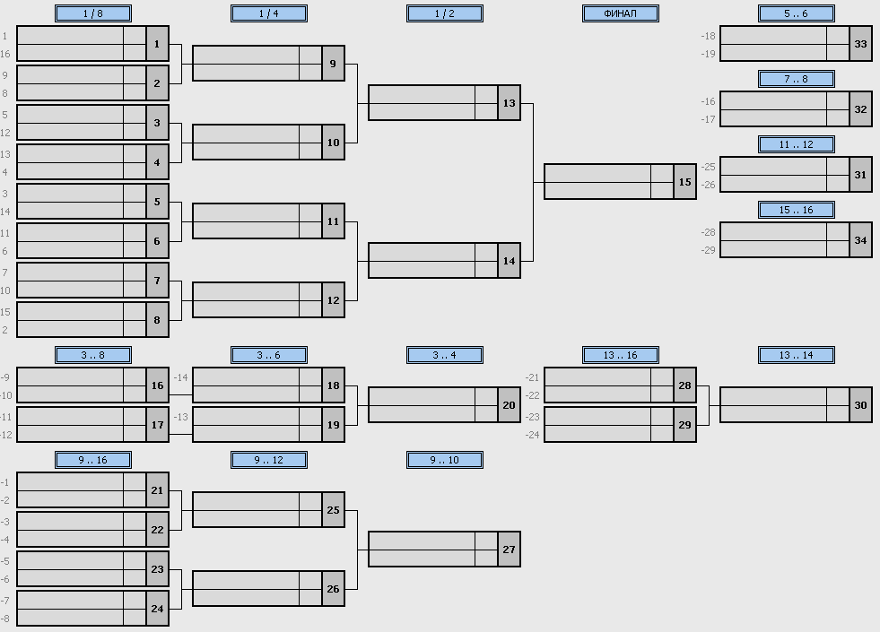

- **Столы и очередь.** Справа в главном окне две панели. «Играется» — одна строка на встречу: стол, этап, минуты, пара (07-008). «В ожидании» — очередь: пары с занятым игроком красные, время ожидания стоит в скобках у фамилии (07-014). Слева от очереди столбец кнопок-столов `1…15`, занятые столы красные. Вызов делается двумя кликами: пара, потом стол.

  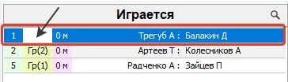

- **Что видит зал:** только картинку выбранного этапа. Во время игры на ней у идущей встречи жёлтая ячейка с текстом `6 ст / 10 м` (стол и минуты, 07-013, 58). Если в настройках включено, на мониторе ещё есть колонка «Дельта рейтинга»: игроки по алфавиту, знак выделен цветом. Отдельного «кто где играет» и «кто следующий» у зала нет.
- **Рейтинг в сетке** включается галкой «Отображать рейтинг в сетке». Её часто забывают, и на форуме жалуются, что рейтинга в сетке нет (`../rttf-tm/03-forum.md`, п. 18).

### 1.2. Что работает

1. Стол и время идущей встречи видны **прямо в таблице группы и в сетке**: игрок находит себя в своей группе и сразу видит стол.
2. Строка «Играется» плотная и читается целиком: `4 | Гр(3) | 4 м | Беляков В : Тарасов А`. Фамилии сокращены до «Фамилия И.», поэтому строки не обрезаются.
3. Конфликты (игрок занят, на столе две встречи) видны цветом сразу, до ошибки.
4. Результаты в группах крупные: `3 : 0` на зелёном, `0 : 3` на красном. Это читается издалека (64-01).
5. Организатор **сам решает**, что показать залу прямо сейчас: «сейчас все смотрят сетку».

### 1.3. Что неудобно

1. Монитор управляется перетаскиванием окна. Без кнопки этапа он показывает не то, а без ручного масштаба сетка либо мелкая, либо обрезана. Видимую область надо выставлять рамкой.
2. Автосмены нет: если организатор занят, зал полчаса видит одну группу.
3. Залу не видно, **где кто играет** и **кто следующий**: эти панели только у организатора.
4. Сетка во всю ширину, а не в высоту экрана: на 32 участниках с утешительными встречами её на ТВ не прочитать.
5. Дельта рейтинга есть только на мониторе, а итоговые места, которые выкладывают скриншотом, часто без рейтинга.
6. Всё держится на одном компьютере организатора: два окна, Windows, его монитор.

**Что берём:** стол и минуты прямо в группе и в сетке, «Фамилия И.» вместо многоточия, цветом показанный конфликт, возможность закрепить нужный слайд. **Что делаем лучше:** экран сам вписывает содержимое в ТВ без ручного масштаба и сам листает, а зал видит столы и очередь.

---

## 2. Наш экран сейчас

Сейчас экран устроен так: слева колонка 36 % (столы, «Следующие», «Последние результаты»), справа доска 64 % листается каждые 15 с. Страницы доски: группы по две, сетка, у закрытого турнира ещё места и рейтинг. Масштаб `scale.ts` считается от ширины экрана (`size(1)` = 1 vw с ограничениями).

### 2.1. Что видно на скриншотах

| Скриншот                           | Что не так                                                                                                                                                                              |
| ---------------------------------- | --------------------------------------------------------------------------------------------------------------------------------------------------------------------------------------- |
| Владелец 1, «Итоговые места»       | Подиум занимает половину экрана, над ним пусто. В местах нет рейтинга и прибавки. Деливших места (5–8, 9–10) показывает прочерком «—».                                                  |
| Владелец 2, «Плей-офф»             | Финал обрезан справа, матч за 3-е место снизу: сетка не вписывается в доску.                                                                                                            |
| Владелец 3, «Изменения рейтинга»   | Отдельный слайд. Формат дельты разный («−27.3» рядом с «+1.94»), минус дефисный.                                                                                                        |
| Владелец 4, идущий турнир          | Пять багов из шага 2 задачи; разбор ниже.                                                                                                                                               |
| Стенд, «Проверка этапа A» сейчас   | 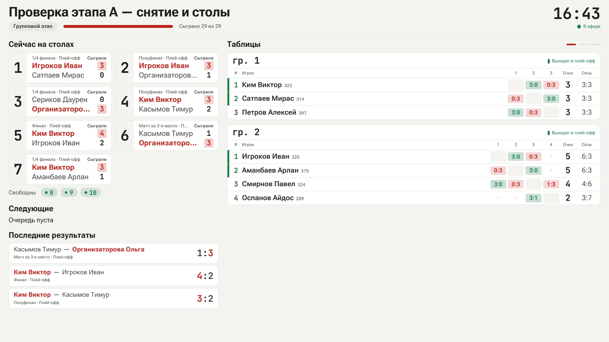 Все 29 встреч сыграны, а на бейдже «Групповой этап». Семь столов «Сыграли», хотя играть нечего. Игроков Иван одновременно на столах 1, 2 и 5.       |
| Синтетика: 10 столов, 8 групп      | 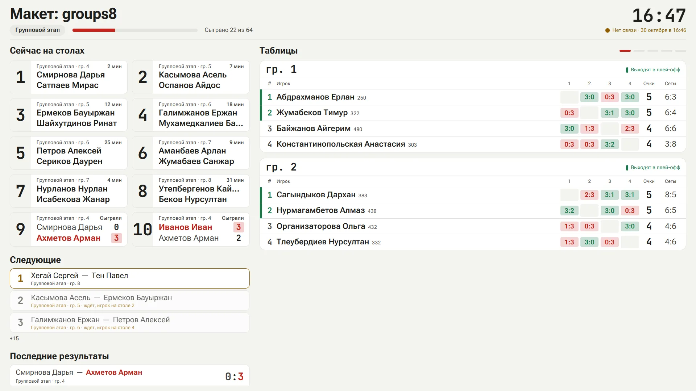 Столы занимают всю левую колонку, «Последние результаты» срезаны снизу. 8 групп идут четырьмя страницами по две, полный круг доски длится 75 с. |
| Синтетика: сетка на 16 после групп | 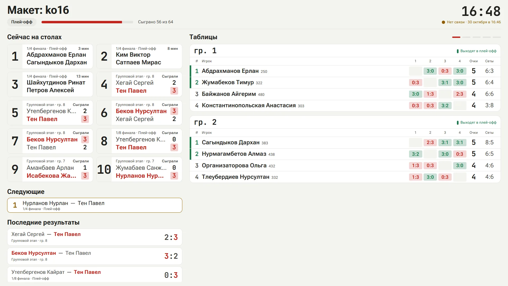 Плей-офф идёт, а на столах висят групповые «Сыграли».                                                                                                 |
| Синтетика: сетка на 32             | 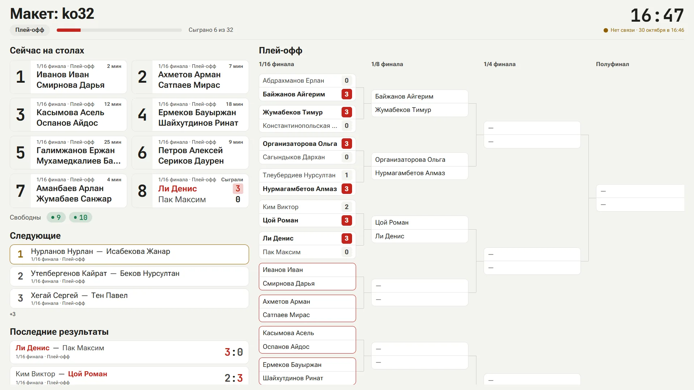 Видны только 1/16 и 1/8, финала нет.                                                                                                                    |
| Синтетика: итоги на 32             | 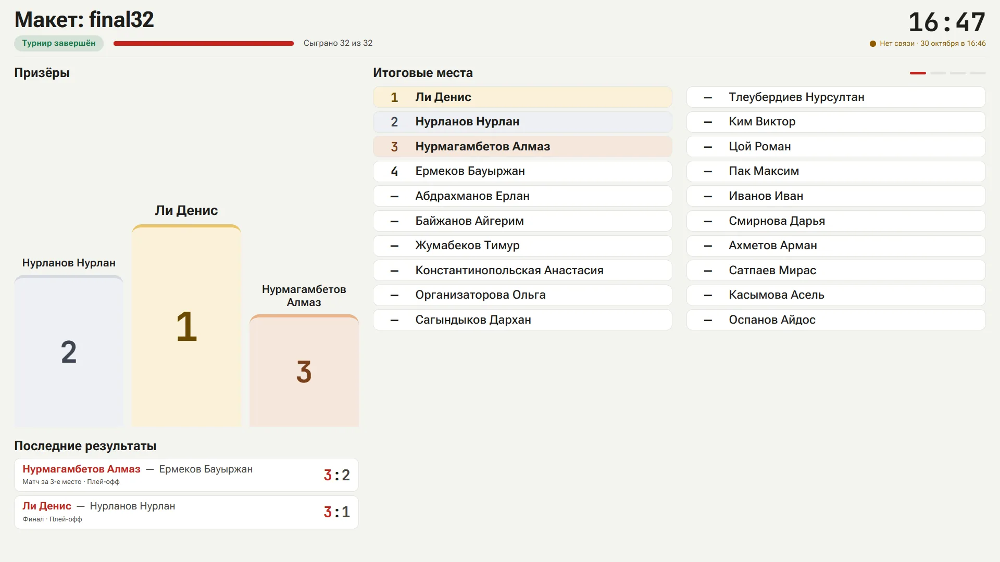 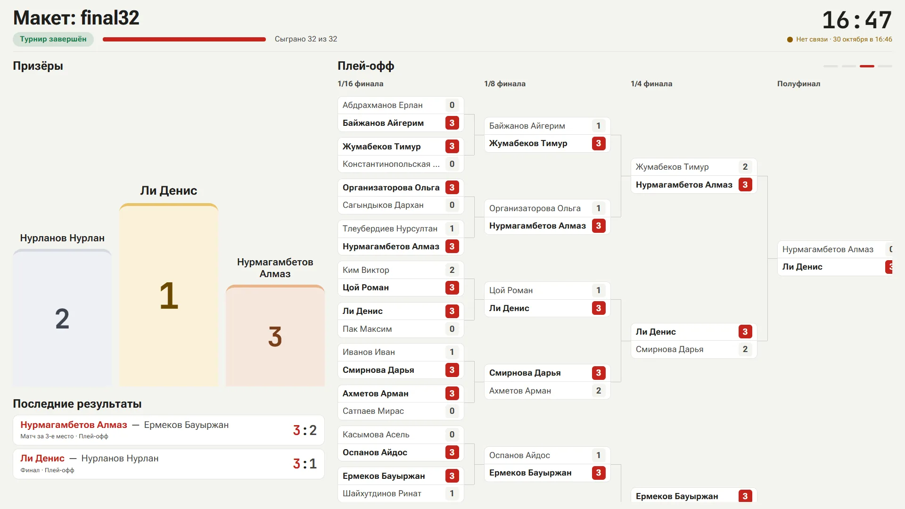 28 человек из 32 с прочерком вместо «5–8», «9–16», «17–32». Сетка обрезана.                            |
| Стенд, рейтинг после турнира       | 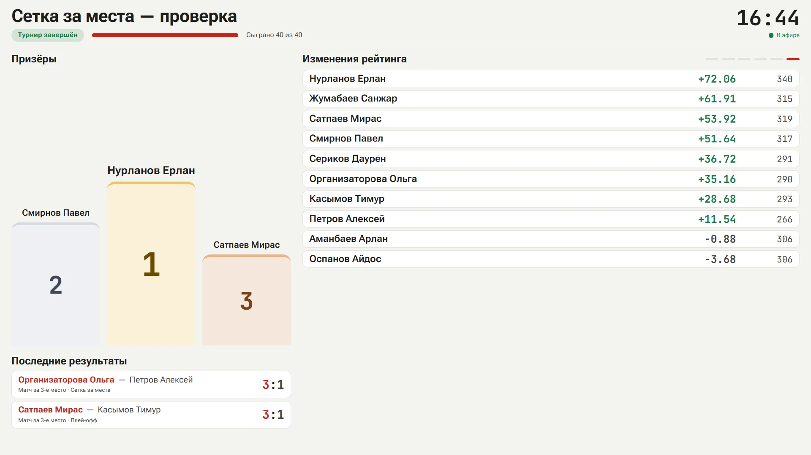                                                                                                                                                  |

При 1366×768 картина та же, только мельче. Отдельная проблема — горизонтальная прокрутка: `scrollWidth` 1385 при ширине окна 1366, 1947 при 1920.

### 2.2. Причины багов (шаг 2 задачи)

| Баг                          | Причина                                                                                                                                                                                                         | Исправление (в любом варианте)                                                                                                                                                                                                                             |
| ---------------------------- | --------------------------------------------------------------------------------------------------------------------------------------------------------------------------------------------------------------- | ---------------------------------------------------------------------------------------------------------------------------------------------------------------------------------------------------------------------------------------------------------- |
| «Сыграли 3:0» держит стол    | `buildTables` (`features/console/queue.ts:237`) считает стол со сыгранной встречей `AWAITING`, **пока на него не позовут следующую пару**. Последний результат там не исчезает до конца турнира.                | На экране сыгранная висит **60 с** с подписью «Сыграли» и счётом, потом стол показывается свободным. Убирается сразу, если один из двоих уже за другим столом или на стол позвали следующую пару. В консоли так же: стол «Свободен», последний счёт мелко. |
| Игрок на двух столах         | Это тот же `AWAITING`: Игроков доиграл четвертьфинал на столе 1 и сел за полуфинал на столе 2. На столе 1 осталась его старая встреча.                                                                          | Правило выше. Сыгранная встреча игрока, который уже за другим столом, не показывается.                                                                                                                                                                     |
| «9545 мин»                   | Время считается верно, от вызова (`startedAt` ставится при назначении стола, `matches.service.ts:109`). Полуфиналы позвали 23.10 и не закрыли до 30.10. Верхней границы у счётчика нет (`tables-board.tsx:76`). | На ТВ минуты показываются до 90; дольше просто «идёт». В консоли с 45 мин время жёлтое, с 90 мин подпись «Долго идёт — проверьте стол».                                                                                                                    |
| «Групповой этап» в плей-офф  | Текущий этап — «первый, где есть несыгранные» (`screen.$publicToken.tsx:215`). Снявшиеся там не учитываются: две встречи Оспанова (снялся) остаются «несыгранными» в группе навсегда.                           | Текущий этап — тот, где идут встречи. Если таких нет, то первый, где есть незакрытые с учётом снятых (`isSettled(match, withdrawn)`), иначе последний.                                                                                                     |
| «Очередь пуста» при 25 из 29 | Очередь считалась **верно**: оставались два идущих полуфинала, а финал и матч за 3-е ещё без участников. Но фраза «Очередь пуста» читается как «турнир встал».                                                  | Когда очередь пуста, а турнир не доигран: «Следующие пары — после встреч на столах 2 и 4». Когда всё сыграно: «Все встречи сыграны».                                                                                                                       |
| Горизонтальная прокрутка     | В `tables-board.tsx:20` «скрытый для глаза» текст для чтеца экрана задан как `width: 1`. В MUI это **100 %**: строка `nowrap` с `position: absolute` вылезает за край.                                          | `width: '1px'`, `height: '1px'`, плюс `overflow: hidden` на `html`/`body` у маршрута экрана.                                                                                                                                                               |
| «Организаторо…»              | `text-overflow: ellipsis` у фамилий во всех досках.                                                                                                                                                             | Правило имени, раздел 3.4.                                                                                                                                                                                                                                 |
| Слайд итогов до загрузки     | Пока итоги закрытого турнира не пришли, рисуются столы. У «Тестового турнира 2» их 32, все `AWAITING`, и колонка уходит на 1916 px вниз.                                                                        | У закрытого турнира столы не рисуются, пока итоги не пришли (вместо них подиум-заглушка).                                                                                                                                                                  |
| «—» вместо «5–8»             | `PlacesBoard` показывает `place ?? '—'`. Делёж мест сервер отдаёт в `results.shared` (ADR-023), а экран его не читает.                                                                                          | Для деливших — диапазон из `shared`: «5–8», «9–16».                                                                                                                                                                                                        |

---

## 3. Общее для всех вариантов

### 3.1. Сцена 1920×1080 и равномерное вписывание

Предлагаю рисовать экран на постоянной сцене 1920×1080 и равномерно вписывать её в любой ТВ (transform `scale`). Сейчас размеры считаются от `vw` с ограничениями `clamp`. Пиксели телевизора не важны: 32″ на 1366×768 и 32″ на 1920×1080 физически одного размера, и доля экрана у кегля одинакова. Зато всё, что видно на скриншоте 1920, будет на любом ТВ ровно так же, и ничего не уедет. Прототипы ниже сделаны именно так, кадры 1366×768 — та же сцена.

Кегли сцены (5 штук, правило website-quality): 16 / 20 / 24 / 32 / 48 px. Как они читаются на 43″ (высота экрана 53 см): 16 px — буква около 8 мм, это 3–4 м; 24 px — около 12 мм, 5–6 м. Ниже 14 px на сцене текста нет. Исключение — сетка на 32 в варианте A, раздел 4.

### 3.2. Сетка: вписывается целиком, при нехватке места зеркальная

- Сетка рисуется в натуральную величину. Затем считается масштаб «вписать в доску» (`min(ширина/W, высота/H)`, не больше 135 %), и пустое место по высоте раздаётся между встречами. Без прокрутки и без обрезки на 8, 16 и 32 участниках.
- **Зеркальная сетка**: половины сходятся к финалу в центре, матч за 3-е место под финалом. Она нужна, когда прямая получается мелкой: прямой на 32 нужно 16 встреч по высоте, зеркальной 8. Выбирается автоматически: зеркальная, если она крупнее прямой хотя бы на 12 %. На 8 и 16 всегда прямая, она привычнее.
- **Рейтинг в сетке**: целым числом, серым после фамилии (`Ким В. 439`), как в группах. Отключать его галкой, как в RTTF, незачем.
- Идущая встреча обведена жёлтым, над ней подпись «стол 3». Стол виден прямо в сетке, как в RTTF.

### 3.3. Итоги: места с рейтингом, отдельный слайд рейтинга убрать

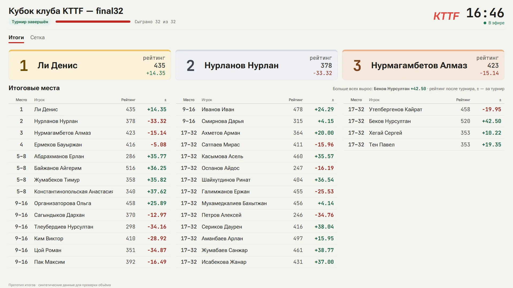

- Подиум сжимается в **одну строку из трёх карточек**: место, полное имя, рейтинг после турнира и прибавка. Было полэкрана, стало 112 px.
- В «Итоговых местах» у каждого: место (для деливших диапазон «5–8»), имя, **рейтинг после турнира** (целым, ADR-053) и **± за турнир** с цветом знака. До 42 строк помещаются тремя колонками без листания.
- **Слайд «Изменения рейтинга» убрать.** Обоснование: его единственное содержание — та же дельта, уже стоящая в строке игрока. Порядок «кто вырос сильнее» теряется, поэтому одной строкой над таблицей добавлено «Больше всех вырос: Беков Н. +42.50». Минус одна страница в ротации: итоги показываются чаще.
- Формат дельты единый: всегда два знака после точки, настоящий минус U+2212, табличные цифры (`+31.51`, `−3.47`, `0.00`). Сейчас `formatDelta` (ADR-077) пишет дефис, а экран вовсе не форматирует строку сервера, отсюда «−27.3». Предлагаю поменять `formatDelta` во всём продукте, тогда консоль, профиль и экран совпадут. Тест `format.test.ts` поменяется.
- Сетка после турнира — тоже целиком: 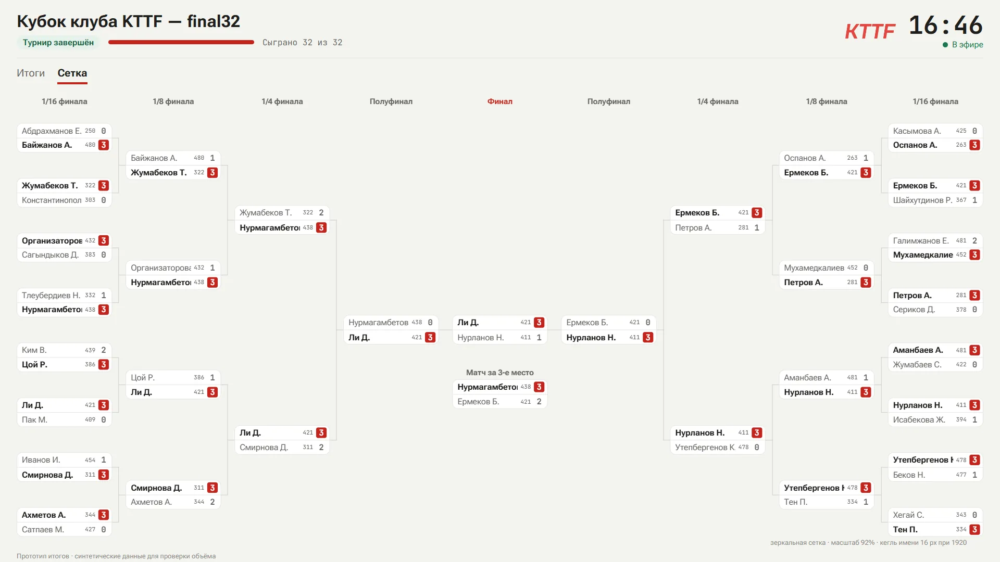

### 3.4. Правило имени

- На досках ТВ (столы, очередь, группы, сетка) пишется «Фамилия И.». Если в турнире два «Ким В.», у обоих полное имя.
- Длинная фамилия **сжимается по ширине**: у Roboto Flex есть ось ширины, допускаем до 75 %. Многоточие ставится только если не помогло и это.
- Полное «Фамилия Имя» — на подиуме и в итоговых местах.

### 3.5. Смена слайдов

Слайды сменяются только через opacity (300 мс). При `prefers-reduced-motion` переход мгновенный. Слайды без содержимого пропускаются: нет групп — нет слайда «Группы», сетка ещё пустая — она в конце круга. Номер слайда считается **от часов**: `floor(now / период)`, а не от таймера каждого экрана. Поэтому два ТВ в зале и предпросмотр в консоли показывают одно и то же. Офлайн это не ломает: экран листает последнее состояние сам (ADR-025).

---

## 4. Варианты компоновки

Цифры ниже для сцены 1920×1080. Нагрузка проверялась синтетикой: 10 столов (8 заняты), 8 групп по 4, сетки на 16 и 32. Все кадры есть и в 1366×768, они идентичны по пропорциям.

### Вариант A. «Табло слева, доска справа»: развитие текущего

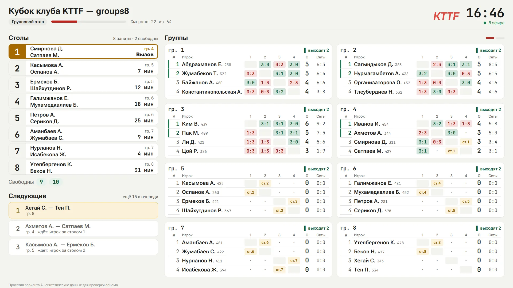
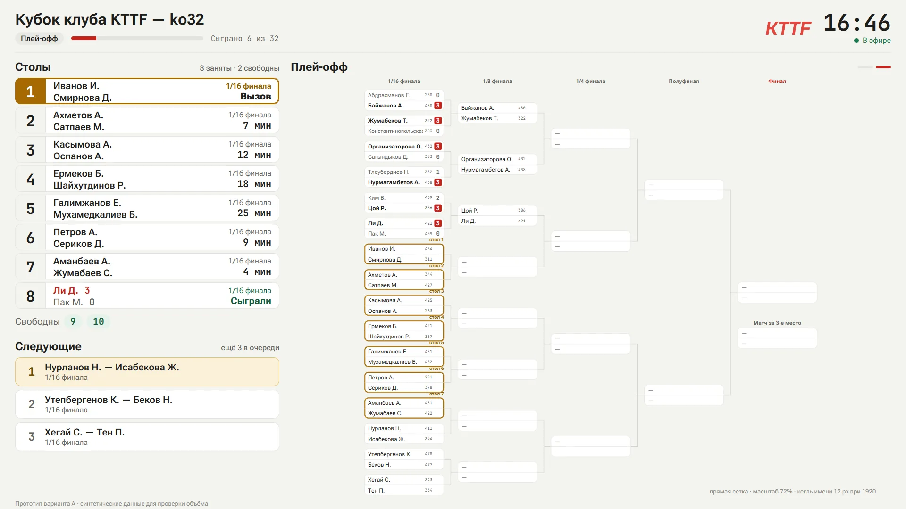

Левая колонка шириной 560 px всегда показывает столы и очередь. Столы идут строками по 56 px: номер, две фамилии, этап и время. Свободные столы собраны в одну строку. «Последних результатов» больше нет: свежий результат минуту стоит на своём столе, а дальше он виден в группе или сетке. Доска 1272×891 справа листает группы (сколько влезает) и сетку.

- **Плюсы:** столы и вызов на экране всегда. Изменение для зала минимальное. 8 групп по 4 помещаются на одну страницу (2×4). Сетка на 16 крупная: имена 20 px.
- **Минусы:** доске достаётся 55 % экрана. **Сетка на 32 мелкая**: 12 px, читается метров с двух. Группы по 6 идут двумя страницами.
- **Свой стол за 3–5 с:** сразу. Вызов — первая строка с оранжевым номером, столы идут по порядку.
- **10 столов / 8 групп / 32:** столы влезают, и ещё 3 строки очереди. Группы — одна страница. Сетка на 32 — слабое место; для неё нужен полноэкранный слайд, и тогда A превращается в B.

### Вариант B. «Экраны по очереди»: идея владельца

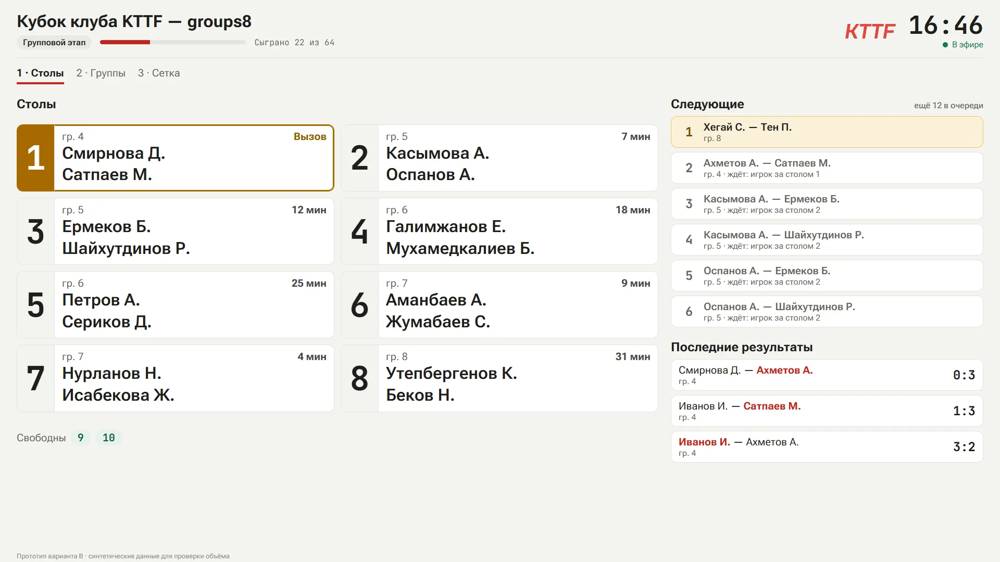
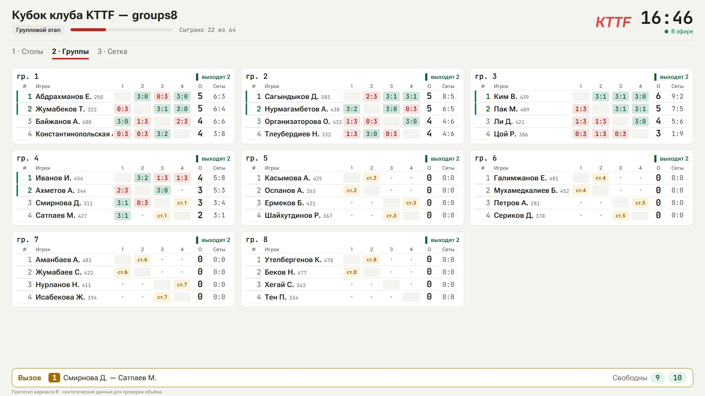
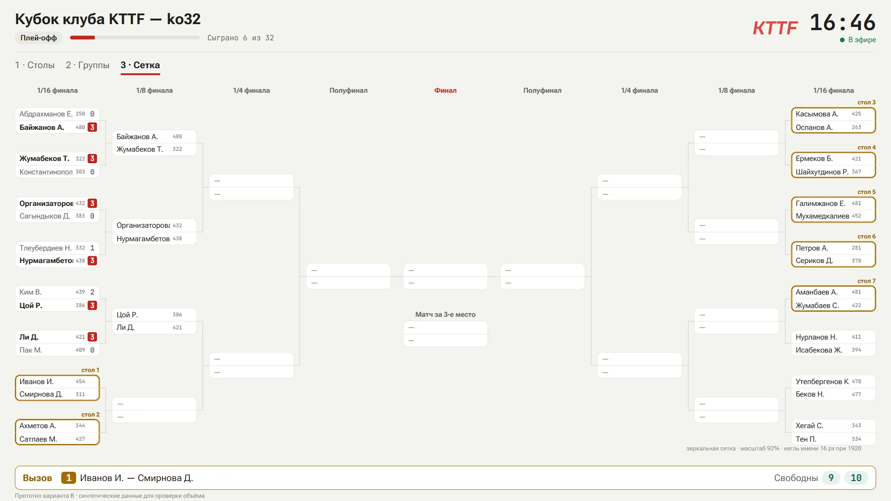

Три экрана на всю ширину:

1. **Столы**: плитки 2×5, номер 64 px, фамилии 32 px. Справа «Следующие» (6 пар) и последние результаты.
2. **Все группы**: подбор колонок по замеру, 8 групп по 4 — 3×3.
3. **Вся сетка**: 1856×794, вписана; на 32 зеркальная.

Сверху вкладки «1 · Столы — 2 · Группы — 3 · Сетка», активная подчёркнута. На экранах 2 и 3 внизу **полоса вызова**: свежие вызовы («Вызов · 1 Иванов И. — Смирнова Д.») и свободные столы. Предлагаемое время: столы 20 с, группы 15 с на страницу, сетка 20 с. Полный круг — 55 с.

- **Плюсы:** у каждого экрана максимум места. Группам и сетке достаётся ~70 % экрана целиком, сетка на 32 — 16 px, на 16 — 21 px. Столы читаются с другого конца зала. Это самый «телевизорный» вид: один экран — один вопрос.
- **Минусы:** полную картину столов зал видит треть времени, «Следующие» тоже. На экранах 2 и 3 остаётся только полоса вызова. Смена всего экрана заметнее, чем смена доски (смягчается opacity без движения).
- **Свой стол за 3–5 с:** если тебя только что позвали, твоя пара в полосе на любом экране. «Где я играю дальше» — в худшем случае ждать до 35 с, пока вернутся «Столы». Можно ещё добавить в полосу первую пару из очереди.
- **10 столов / 8 групп / 32:** всё влезает без листания внутри экрана. Группы по 6 (8 штук) — две страницы.

### Вариант C. «Полоса столов сверху, доска во всю ширину»

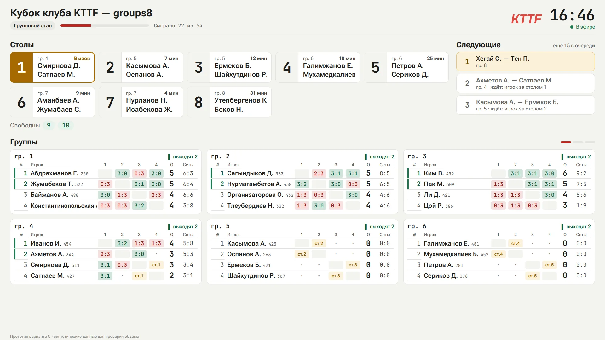
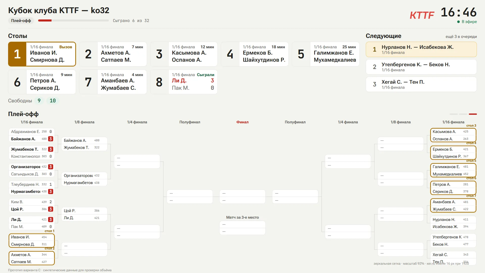

Сверху полоса высотой около 280 px: плитки столов 5×2 и справа три пары «Следующие». Под ней доска на всю ширину, 1856×582, листает группы и сетку.

- **Плюсы:** столы видны всегда, а доска широкая. Широкой зеркальной сетке это подходит: 32 участника — 16 px.
- **Минусы:** доска невысокая. 8 групп не помещаются, получается 2 страницы по 6. Плитки на 5 колонок узкие: длинные фамилии сжимаются сильнее (22 px, ширина до 75 %). При 4 столах полоса полупустая.
- **Свой стол за 3–5 с:** сразу. Плитки по номеру слева направо, вызов оранжевый.
- **10 столов / 8 групп / 32:** столы помещаются. Группы — 2 страницы. Сетка на 32 — да, но сжата по высоте.

### Сводка

|                                | A: табло + доска | B: экраны по очереди    | C: полоса + доска          |
| ------------------------------ | ---------------- | ----------------------- | -------------------------- |
| Доля экрана под группы и сетку | 55 % всегда      | ~70 % на своём экране   | 52 % всегда                |
| 8 групп по 4                   | 1 страница       | 1 экран                 | 2 страницы                 |
| Сетка на 16, кегль имени       | 20 px            | 21 px                   | 18 px                      |
| Сетка на 32, кегль имени       | **12 px**        | 16 px (зеркальная)      | 16 px (зеркальная, низкая) |
| Столы видны                    | всегда           | экран 1 + полоса вызова | всегда                     |
| «Следующие» видны              | всегда (3)       | экран 1 (6)             | всегда (3)                 |
| Изменение для привыкших        | малое            | заметное                | среднее                    |

**Рекомендация — B.** Это идея владельца, она и даёт больше всего места. На вопрос «где я играю», если он возникает на другом экране, отвечает полоса вызова. Её стоит усилить первой парой очереди: «Следующие: Хегай С. — Тен П.». A стоит выбрать, если турниры в клубах в основном до 16 человек и на 4–6 столах: на таком объёме A проще и спокойнее, а его слабое место (сетка на 32) не наступает.

---

## 5. Консоль

### 5.1. Сейчас

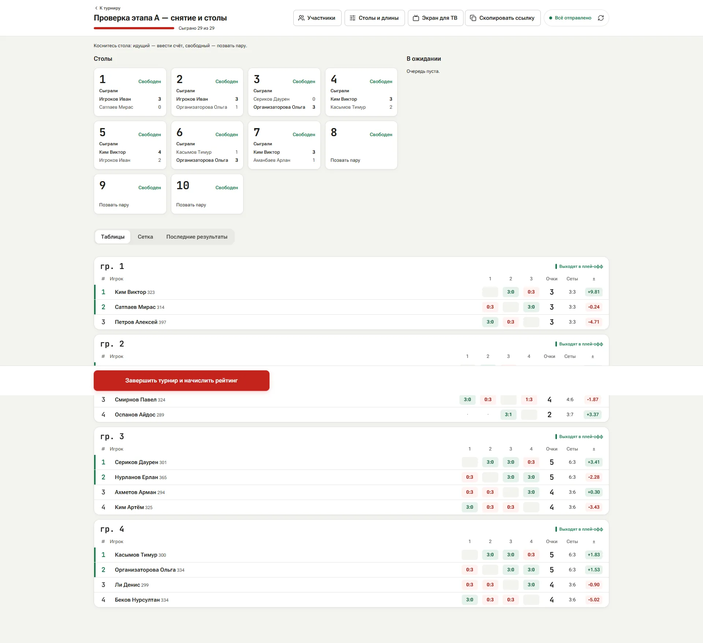

Сверху столы и «В ожидании», ниже вкладки «Таблицы / Сетка / Последние результаты». Сделано по образцу RTTF «Играется / В ожидании» и работает. Что путает:

- после игры каждый стол «Свободен», но с чужим старым счётом. Девять столов «Сыграли», когда играть нечего;
- нигде не видно, что сейчас показывает ТВ. Кнопка «Экран для ТВ» открывает вкладку, а что на ней, организатор не знает;
- нет предупреждения о встрече, забытой за столом («9545 мин»);
- фамилии в плитках обрезаются многоточием.

### 5.2. Предложения

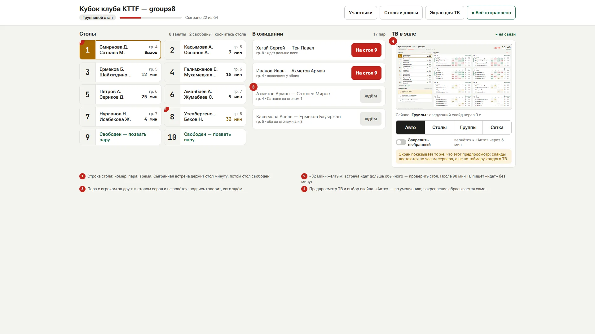

1. **Столы компактнее.** Номер, две фамилии по правилу имени, этап и время. После минуты сыгранная встреча уходит, стол просто «Свободен — позвать пару» (кнопка-цель 44 px остаётся). С 45 минут время жёлтое, с 90 минут подпись «Долго идёт — проверьте стол».
2. **Очередь говорит, кого ждём.** Серая пара «ждём» с причиной: «Сатпаев за столом 1». Если очередь пуста, а турнир не доигран: «Следующие пары — после столов 2 и 4».
3. **Карточка «ТВ в зале».** Живой предпросмотр в 1/5 размера, строка «Сейчас: Группы, следующий слайд через 9 с», ссылка «Открыть / скопировать».
   - Предпросмотр рисуется **теми же компонентами экрана из состояния консоли**, а не через `iframe`. `iframe` запрещён нашей CSP (`frame-ancestors 'none'`), а компоненты работают и офлайн, из локального состояния консоли.
   - Совпадение с ТВ даёт ротация по часам (3.5).
4. **Управление экраном из консоли (по выбору владельца):** «Авто · Столы · Группы · Сетка · Итоги» и «Закрепить», с возвратом в «Авто» через 5 минут. Это аналог кнопок «Второй монитор» в RTTF, но с автосменой по умолчанию.
   - Цена — сервер: поле закрепления у турнира, маршрут и событие в потоке экрана. Это shared + back + front, около дня работы.
   - Действие сетевое: офлайн кнопки неактивны с подсказкой, как у «Завершить турнир». Офлайн-очередь результатов это не трогает.
   - **Предлагаю сделать вторым шагом.** Предпросмотр нужен сразу, закрепление — если владелец видит в нём смысл («показать сетку сейчас» перед финалом).
5. Бейдж этапа и прогресс в шапке консоли считать теми же функциями, что на ТВ: как сейчас, но с исправленным «текущим этапом».

Сохраняется: офлайн-очередь и метка синхронизации, focus ring в консоли и на экране (они вне `data-focus='quiet'`), все кнопки ≥44 px.

---

## 6. Что нужно от владельца

1. **Вариант экрана:** A, B (рекомендую) или C. Можно смешать, например «B, но на турнирах до 16 — A».
2. **Слайд «Изменения рейтинга»:** убрать, как в 3.3, или оставить.
3. **Управление экраном из консоли** (5.2, п. 4): делать сейчас, вторым шагом или не делать. Предпросмотр делается в любом случае.
4. Время слайдов: столы 20 с, группы 15 с, сетка 20 с. Подходит?
5. Минус U+2212 и два знака в дельте **везде** (консоль, профиль), не только на ТВ?

## 7. План после выбора

- ADR в `06-decisions.md`: компоновка, сцена 1920×1080, вписывание сетки, правила стола (60 с, 90 мин), ротация по часам, итоги без слайда рейтинга.
- `kttf-front`, ветка `feat/hall-screen`:
  - `features/screen/*`: сцена, слайды, правило имени, вписывание сетки;
  - `common/ui/bracket*`: зеркальная раскладка и рейтинг;
  - `features/console/queue.ts`: правило стола, текущий этап;
  - `finale.tsx`: места с рейтингом и диапазонами;
  - консоль: столы, очередь, «ТВ в зале».
- Тесты: `screen.test.tsx` (баги из 2.2 — по одному тесту на каждый), `console.test.tsx`, `queue.test.ts`, `format.test.ts`.
- Скриншоты каждого слайда и состояния при 1920×1080 и 1366×768. Пересобрать `kttf-web` на https://localhost.

Прототипы в `proto/` (статичный HTML на синтетике, без сборки). Шрифты и данные к ним лежат локально в `kttf-shots/screen-analysis/proto/`, в репозиторий не положены.
